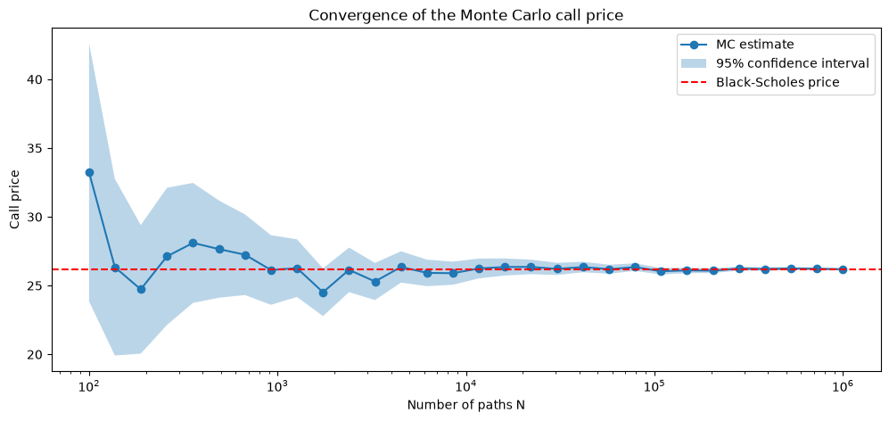

# Monte Carlo option pricing

A Jupyter notebook that prices options on Apple stock, first with the Black-Scholes formula and then by simulating the share price as geometric Brownian motion. I used it to see how fast Monte Carlo converges, how variance reduction speeds it up, and how the same simulation handles Asian and barrier options that have no simple formula. It uses NumPy, SciPy, matplotlib and yfinance.



## How it works

1. Download AAPL closing prices for 2024 with `yfinance`. The spot price is the last close of the year and the volatility is the annualised standard deviation of daily log returns. The option has strike 250, one year to expiry and an assumed risk-free rate of 4%.
2. Price a European call and put with the Black-Scholes formula and check put-call parity, both at one strike and across 41 strikes.
3. Simulate GBM paths with daily steps and compare the distribution of the final price with the lognormal density.
4. Price the call by Monte Carlo for N from 100 to 1,000,000 paths with 95% confidence intervals. Then repeat the pricing 100 times at each of seven values of N and fit a line to the log-log plot of root mean squared error against N.
5. Compare plain Monte Carlo with antithetic variates and with a control variate (the discounted final price, whose mean is the spot price), using 100,000 payoffs for each.
6. Price an arithmetic average-price Asian call with daily averaging. I check the simulation against the closed-form price of the geometric Asian call, then use the geometric option as a control variate for the arithmetic one.
7. Price an up-and-out barrier call with the barrier at 1.3 times the spot and daily monitoring, and plot its price as the barrier moves.
8. Estimate delta and gamma with central finite differences, both on the Black-Scholes formula and on the Monte Carlo price using common random numbers, and compare with the analytic formulas. A final plot shows how the finite difference error depends on the bump size.

The equations for each step are written out in the notebook's markdown cells.

## Results

The spot price was 248.62 and the historical volatility 0.2232.

| Quantity | Value |
|---|---|
| Black-Scholes call | 26.1877 |
| Black-Scholes put | 17.7693 |
| Largest put-call parity error over 41 strikes | 5.7e-14 |
| Monte Carlo call, 100,000 paths | 25.9604 ± 0.2453 (95% CI) |
| Monte Carlo put, 100,000 paths | 17.8281 ± 0.1587 (95% CI) |
| Fitted slope of log(RMSE) against log(N) | -0.496 |

All 30 confidence intervals in the convergence plot contained the Black-Scholes price, and the fitted slope is close to the -0.5 expected from the 1/sqrt(N) rate.

Variance reduction for the European call with 100,000 payoffs:

| Method | Price | Standard error | Variance reduction |
|---|---|---|---|
| Plain Monte Carlo | 26.2381 | 0.1255 | 1.00x |
| Antithetic variates | 26.1562 | 0.0946 | 1.76x |
| Control variate | 26.1459 | 0.0505 | 6.18x |

The payoff and the control had a correlation of 0.9155.

Exotic options with 100,000 paths of 252 daily steps:

| Option | Price | Notes |
|---|---|---|
| Geometric Asian call (MC) | 13.6708 | 95% CI ± 0.1270, closed form 13.7356 |
| Arithmetic Asian call, plain MC | 14.2824 | standard error 0.0674 |
| Arithmetic Asian call, geometric control variate | 14.3498 | standard error 0.00207 |
| Up-and-out call, barrier 323.20 | 6.8451 | 95% CI ± 0.0882 |

The geometric control variate reduced the variance of the Asian price by about 1063 times because the two payoffs had a correlation of 0.99953. In the barrier case 24.4% of paths were knocked out, which is why it is much cheaper than the vanilla call.

| Greek | Analytic | Finite difference on BS (h = 1) | Finite difference on MC (h = 1, 1M paths) |
|---|---|---|---|
| Delta | 0.60485 | 0.60484 | 0.60439 |
| Gamma | 0.00694 | 0.00694 | 0.00686 |

On the exact formula the smallest delta error was 1.8e-12 at h around 0.001 and the smallest gamma error was 5.6e-11 at h around 0.017. Below those sizes rounding error takes over, and much sooner for gamma.

## Repository layout

| Path | What it is |
|---|---|
| `option_pricing.ipynb` | The whole project: Black-Scholes, GBM simulation, Monte Carlo pricing, variance reduction, exotic options and Greeks |
| `images/convergence.png` | The convergence plot from the notebook |
| `requirements.txt` | Python packages used by the notebook |

## Running it

```
pip install -r requirements.txt jupyter
jupyter notebook option_pricing.ipynb
```

The notebook needs an internet connection because `yfinance` downloads the price data. It runs in about 10 seconds on a laptop CPU, and the random seed is fixed at 42.

## Limitations

The risk-free rate of 4% is assumed, and the volatility is historical rather than implied from market option prices, so the prices are not meant to match real AAPL options. The model ignores dividends. The barrier and Asian options are monitored at daily steps only.

This was written by AI for learning practice.
